# shared-brain

*Stop re-explaining your project to every AI you use.*

I use Claude on the web for thinking, ChatGPT for second opinions, and Claude Code for the actual work. All three are smart. None of them talk to each other.

Every time I switched tools, I found myself re-explaining what the plan was, which options we had already ruled out, and what the next step was supposed to be.

So I gave them a shared brain.

shared-brain is a small, self-hosted memory layer that any MCP-capable assistant can plug into. A decision made in ChatGPT on Monday is something Claude Code already knows on Wednesday.

It is not magic, it is a Postgres table with vectors in it. But it changed how I work more than I expected.

## How it works

<p align="center">
  
</p>

**One memory, one sentence.** Each entry is a self-contained sentence, tagged with the project it belongs to, who wrote it (`claude-web`, `chatgpt`, `claude-code`, or any other client) and when.

**Found by meaning, not exact words.** Every entry also gets an embedding. Ask "what did we decide about the evaluation metric?" and it finds "switched primary metric to CIDEr", even though not a single word overlaps.

**The server is deliberately dumb.** It stores, embeds, searches, and checks for near-duplicates. It never runs an LLM of its own.

When something looks like a duplicate, it hands the existing entry back to the assistant that called it and says "you decide": update the old one, or save again with clearer wording. The assistant already has the conversation context; the server does not need it.

## The tools

| Tool | What it does |
|---|---|
| `save_memory` | Save one fact, decision or status, with a `kind`. |
| `update_memory` | Correct wording or reclassify kind/tags. |
| `retire_memory` | Mark an entry as no longer valid, without deleting it. |
| `search_memory` | Hybrid search within one project: meaning plus keywords. |
| `recent_memories` | Newest first by last change. Good for "what happened this week." |
| `delete_memory` | For things that were wrong from the start. |

A few details:

- `save_memory` refuses near-duplicates (cosine ≥ 0.9 by default) and returns the existing entry instead. With `supersedes=<id>` it replaces an outdated entry while keeping the old one as history.
- `update_memory` archives the old wording automatically through a database trigger, because assistants sometimes "update" by writing something shorter.
- `retire_memory` is for a resolved blocker, or a state that no longer applies.
- `search_memory` and `recent_memories` take an optional `kinds` filter. Superseded and retired entries only show up with `include_history`.
- Outdated is not wrong: retire or supersede instead of deleting.

## Design choices

**Why kinds.** Every memory has a `kind`: `state`, `decision`, `blocker`, `context`, `log` or `session-summary`. Kinds matter because they age differently. A decision stays true until it is reversed; a state is wrong the moment the next one arrives; a blocker should disappear once solved.

**Why supersede instead of overwrite.** A new state *supersedes* the old one. Normal search shows only what is true now, while the path that led there stays queryable. (Same idea as the bi-temporal edges in [Graphiti](https://github.com/getzep/graphiti), scaled down to two columns.)

**Why hybrid search.** Embeddings are good at "what did we decide about evaluation?" and bad at exact names. Project vocabulary is full of exact names (`Memobase`, `emotion2vec`, `BERSt`), and short Chinese queries against mixed-language entries often score low on cosine similarity alone.

Trigram matching (pg_trgm) catches those. Reciprocal rank fusion merges the two rankings without having to tune weights.

**Why a project whitelist.** Project names are whitelisted (`ALLOWED_PROJECTS`) so three assistants cannot invent three spellings of the same project and quietly split your memory into three piles. Yes, this happened during testing. Yes, the whitelist caught it.

## Setting it up

You need:

- a Supabase project (free)
- an OpenAI key, for embeddings only (a one-time $5 lasts a very long time)
- somewhere to run a Python process (Render free tier works)

<details>
<summary><b>Step-by-step setup</b></summary>

1. **Database.** In the Supabase SQL Editor, run `schema.sql`, then the files in `migrations/` in order. Row Level Security is on with no public policies, so only your server can touch the table.

2. **Environment.** `cp .env.example .env` and fill it in. `MCP_SECRET_PATH` is the output of `openssl rand -hex 24`. It becomes the URL path and is the only thing standing between the internet and your memories, so treat it like a password.

3. **Run it locally.**

   ```bash
   pip install -r requirements.txt
   python server.py
   ```

   Then point the MCP Inspector (`npx @modelcontextprotocol/inspector`) at `http://localhost:8000/<MCP_SECRET_PATH>` and save something.

4. **Deploy.** Push to GitHub and create a Render Web Service from the repo: start command `python server.py`, the same env vars, plus `PYTHON_VERSION=3.12.0`. Free instances nap after 15 minutes of silence and take a few seconds to wake up. Acceptable.

5. **Connect the assistants.** The connector URL is `https://<your-service>.onrender.com/<MCP_SECRET_PATH>`.

   | Client | Where to add it |
   |---|---|
   | Claude web | Settings > Connectors > Add custom connector |
   | ChatGPT desktop | Settings > Plugins > Add MCP server (Streamable HTTP, no auth) |
   | Claude Code | `claude mcp add --transport http --scope user shared-brain <URL>`, on every machine it runs on |

6. **Tell them when to use it.** Tools alone do nothing; the assistant has to know when to reach for them. Put standing instructions in Claude (Profile or Project instructions), ChatGPT (Custom instructions) and Claude Code (`~/.claude/CLAUDE.md`). Mine says roughly:

   > When I mention a project or ask what we decided, search shared memory first. When I make a decision, change a plan or hit a milestone, save one short self-contained entry. When updating, keep the details and change only what changed. Never store secrets, credentials, personal data, or details of security or compliance incidents.

   Then add one line per project in its Claude Project, ChatGPT Project and repo `CLAUDE.md`: "the shared-memory project name is X." After that, "save that" is enough.

</details>

## What it is like to use

Mostly you forget it is there. You talk about the project, the assistant quietly searches. You say "ok, we go with Astro" and it quietly saves.

Once a week I open the Supabase table editor, which looks like a spreadsheet, and delete anything that has gone stale.

**The moment it clicked.** Claude Code, running on a remote machine, wrote a batch of project state into memory late one night. The next morning I opened a fresh Claude web chat and asked "what's waiting on my decision?" and got a correct, prioritised list. I had not typed any of it.

## Things I learned the hard way

- The `mcp` Python package shipped a 2.0 the week I built this and renamed `FastMCP`. Pin `mcp<2` or migrate. Pin.
- Claude Code passes list arguments as JSON strings sometimes. `server.py` coerces them.
- "Don't store sensitive data" is not specific enough. An assistant will happily avoid the data itself and then store a paragraph *about* it. Spell out what sensitive means.

## Where this is going

**Stage 3 (next): make it feel continuous, not just searchable.**

Right now the assistants retrieve on request. A person walks into a conversation already knowing where things stand. So:

1. A `project_brief` tool that assembles "where are we": recent progress, open decisions, blockers, last session summary. Called at the start of every project conversation.
2. Session summaries written automatically by Claude Code via a `Stop` hook, so the state is always fresh even if the SSH session dies.
3. ~~Fixed memory types and type filtering.~~ Done in migration 002, together with supersede/retire and hybrid search.
4. Project registry in the database instead of an env var.

**Stage 4 (someday):** OAuth instead of a secret path, a tiny dashboard, maybe Supabase Edge Functions instead of Render.

## Inspiration

Projects I read while designing this:

- [AusDavo/mcp-memory-server](https://github.com/AusDavo/mcp-memory-server): same stack, taught me about embedding-model tracking and list coercion
- [Caricalia/mcp-brain](https://github.com/Caricalia/mcp-brain): cross-client architecture
- [rnblanco/supa-brain](https://github.com/rnblanco/supa-brain): tool design
- [open-brain-server](https://github.com/Bobby-cell-commits/open-brain-server): dedup and pruning ideas

## Repository

```
server.py                    the MCP server
schema.sql                   initial database setup
migrations/001_history.sql   memory_history table + trigger
migrations/002_kinds_validity_hybrid.sql   memory kinds, supersede/retire, hybrid search (backs up both tables first)
requirements.txt
.env.example
CLAUDE.md                    instructions for Claude Code when working on this repo
docs/architecture.svg        animated architecture diagram used in this README
```
